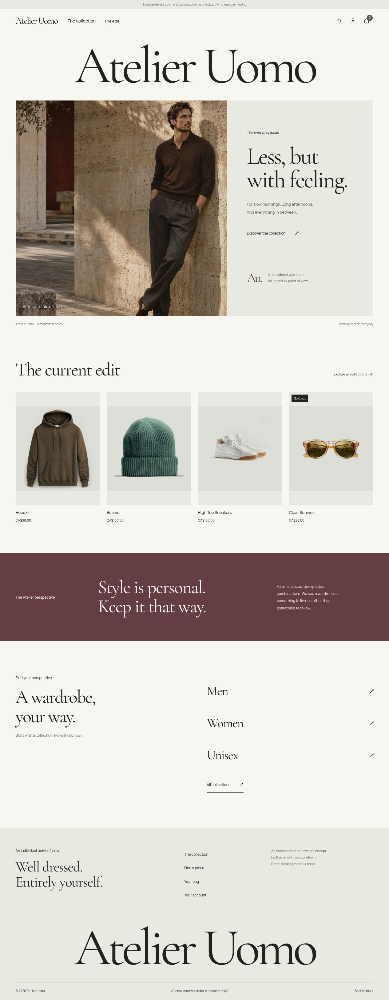

# Atelier Uomo

An editorial menswear storefront built with React, TypeScript, Shopify Hydrogen, and React Router SSR.

This portfolio project explores a complete shopping flow: collection browsing, product variants, search, cart management, and a demonstration checkout.

## Preview



## Stack

- React 19 and TypeScript
- React Router 7 with server-side rendering
- Shopify Hydrogen 2026.10
- Shopify Storefront API and GraphQL
- Tailwind CSS 4
- Playwright and Node.js test runner
- GitHub Actions

## Features

- Responsive editorial homepage and shared visual identity
- Collection browsing and product search
- Product details with variant selection
- Cart drawer and full cart page
- Quantity updates, removal, and cart persistence
- Mock checkout handoff that preserves the cart ID
- Mobile navigation and accessible dialog controls

## Run locally

Use Node.js 24 and npm.

```bash
nvm use
npm ci
npm run dev
```

Open the URL printed by Vite.

The default catalog uses mock.shop and requires no Shopify account or API token. Optional environment variables are documented in `.env.example`. Never commit credentials.

## Checks

```bash
npm run typecheck
node --experimental-strip-types tests/checkout.test.ts
npm run build
```

Typecheck includes React Router type generation, TypeScript, and Hydrogen GraphQL validation.

## Browser tests

Install Chromium once:

```bash
npx playwright install chromium
```

Run the tests:

```bash
npm run test:e2e
```

Interactive mode and HTML report:

```bash
npm run test:e2e:ui
npm run test:e2e:report
```

The four browser scenarios cover:

1. Homepage → collection → product navigation.
2. Cart quantity updates, persistence after reload, removal, and checkout URL.
3. Search results → product navigation.
4. Mobile menu → collections navigation.

Cart tests verify server state as well as the optimistic interface.

These are integration tests against live mock.shop data. They require network access and may be affected by catalog changes or service availability. Each test uses an isolated browser context. Failed runs retain traces and screenshots for diagnosis.

Four unit tests cover the mock checkout URL helper, including query parameter preservation and unchanged behavior for real Shopify checkout domains.

## Continuous integration

The GitHub Actions workflow is configured to run:

- Dependency installation with `npm ci`
- TypeScript and GraphQL checks
- Checkout unit tests
- Production build
- Chromium browser tests
- Test report upload

Its first GitHub run must pass before CI is considered verified.

## Project structure

- `app/routes/` — page components, server loaders, and route metadata
- `app/components/` — shared interface components
- `app/lib/` — Storefront API integration, cart helpers, and configuration
- `app/tokens.css` — shared design tokens
- `app/app.css` — application and editorial styles
- `public/fonts/` — locally hosted fonts and their licenses
- `public/images/` — campaign image and generation prompt
- `tests/checkout.test.ts` — checkout helper unit tests
- `tests/e2e/` — Playwright integration tests
- `server.ts` — Oxygen Worker entry point
- `.github/workflows/ci.yml` — automated checks

## Design and attribution

The interface follows an Italian fashion editorial direction: expressive typography, an asymmetric campaign layout, restrained colors, and a quieter product presentation.

The campaign image was generated with AI for this fictional brand concept. It does not depict a purchasable catalog item. Product data and product images come from mock.shop.

Fonts are hosted locally, with license files included in `public/fonts/`.

The application is based on Shopify’s Hydrogen React Router template. Custom work includes the Atelier Uomo visual identity, editorial interface, mock checkout cart handoff, and test coverage.

## Demo limitations

- The catalog and inventory are fictional.
- Checkout takes no real payment and creates no real order.
- Customer Account login requires a real Shopify store.
- The sample catalog is not yet fully curated for a menswear brand.
- Prices and currency follow API data.
- An intermittent empty-cart result was observed during testing; failure traces are retained to support further diagnosis.
- Development dependencies and runtime compatibility require continued review before production use.

## Known warnings

The current toolchain emits an `envFile` deprecation warning and React Router v8 future-flag notices. These do not currently prevent typechecking, builds, or the tested shopping flows.

## License

MIT. See `LICENSE`.